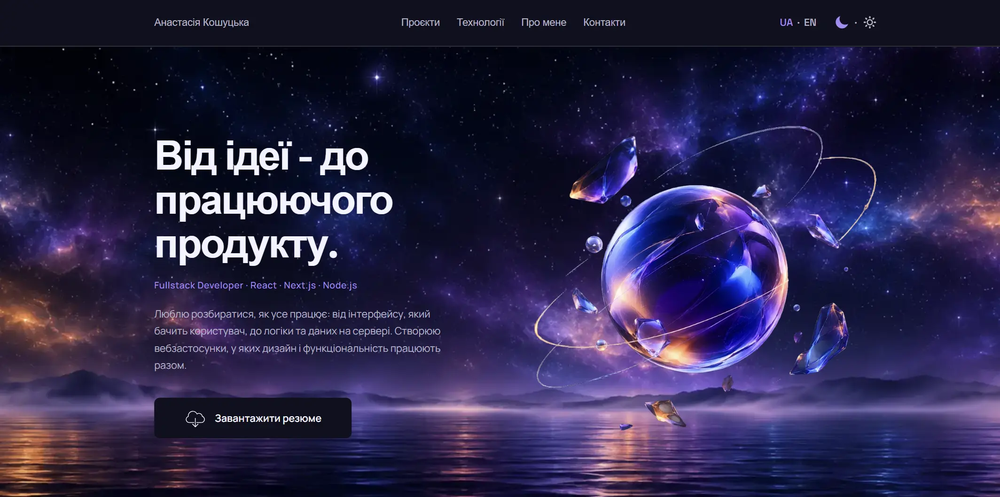

# Anastasiia Koshutska — Portfolio

A personal portfolio website showcasing my projects, technical skills, and
background as a Fullstack Developer.

## Preview



## Live Demo

[Portfolio](https://portfolio-mu-khaki-67.vercel.app/)

## About the Project

This portfolio presents my development journey, selected projects, and
technologies I use to build web applications — from user interfaces to
server-side logic.

The website is designed with a responsive layout and a custom visual style
inspired by cosmic landscapes.

## Features

- **Responsive design** — optimized for mobile, tablet, and desktop screens.
- **Bilingual interface** — Ukrainian and English language support.
- **Theme switcher** — dark and light themes with saved user preference.
- **Projects showcase** — project descriptions, screenshots, technology stacks,
  GitHub repositories, and live demos.
- **Interactive project galleries** — image sliders powered by Swiper.
- **Scroll animations** — smooth reveal effects for page sections.
- **CV download** — direct access to my resume.

## Technologies

- React 19
- TypeScript
- Vite
- React Context API
- CSS Modules
- Swiper
- usehooks-ts

## Featured Projects

| Project          | Description                                                                                                                                                                      | Technologies                                          |
| ---------------- | -------------------------------------------------------------------------------------------------------------------------------------------------------------------------------- | ----------------------------------------------------- |
| **RecipeBook**   | Personal recipe management application. Independently developed frontend and backend, including authentication, recipe management, favorites, search, filtering, and pagination. | Next.js, TypeScript, Node.js, Express, MongoDB        |
| **Harmoniq**     | Content platform connecting readers and authors. Contributed to author pages, profiles, data fetching, caching, and API development as part of a team.                           | Next.js, TypeScript, TanStack Query, Node.js, MongoDB |
| **PetLove**      | Pet adoption platform featuring searchable listings, favorites, viewed listings, and user profile management.                                                                    | Next.js, TypeScript, Redux Toolkit, REST API          |
| **ReGarden**     | Responsive promotional website for a mobile Match-3 game.                                                                                                                        | HTML5, CSS3, JavaScript, Swiper                       |
| **TravelTrucks** | Camper rental application with catalog filtering, vehicle details, and booking request form.                                                                                     | Next.js, TypeScript, TanStack Query                   |
| **Mebleria**     | Responsive furniture e-commerce website. Worked as Scrum Master and contributed to frontend development.                                                                         | HTML5, CSS3, JavaScript, REST API                     |

## Tech Stack

**Frontend**

- HTML5, CSS3, JavaScript, TypeScript
- React, Next.js
- React Router, CSS Modules

**State Management & Data Fetching**

- Redux Toolkit, Zustand
- TanStack Query, Axios

**Forms & UI**

- React Hook Form, Formik, Yup
- Swiper, TipTap, React Paginate, React Hot Toast

**Backend**

- Node.js, Express.js
- REST API, JWT, bcrypt
- Mongoose, Joi, Celebrate
- Multer, Nodemailer

**Databases & Services**

- MongoDB, Cloudinary

**Tools & Deployment**

- Git, GitHub, Vite
- Vercel, Render
- Swagger, Figma, Trello

## Getting Started

### Prerequisites

- Node.js
- npm

### Installation

1. Clone the repository:

   ```bash
   git clone https://github.com/Anastasiia-Kosh/Portfolio.git
   ```

2. Navigate to the project directory:

   ```bash
   cd Portfolio
   ```

3. Install dependencies:

   ```bash
   npm install
   ```

4. Start the development server:

   ```bash
   npm run dev
   ```

5. Open the local URL provided by Vite in your browser.

### Available Scripts

| Command           | Description                                           |
| ----------------- | ----------------------------------------------------- |
| `npm run dev`     | Starts the development server                         |
| `npm run build`   | Runs TypeScript checks and creates a production build |
| `npm run lint`    | Runs ESLint                                           |
| `npm run preview` | Previews the production build locally                 |

## Project Structure

```text
src/
├── components/    # Page sections and reusable UI components
├── context/       # Language and theme providers
├── data/          # Project and technology data
├── hooks/         # Custom React hooks
├── locales/       # Ukrainian and English translations
├── App.tsx        # Main application component
└── main.tsx       # Application entry point
```

## Author

**Anastasiia Koshutska**

Fullstack Developer

- GitHub: [Anastasiia-Kosh](https://github.com/Anastasiia-Kosh)

---

Thank you for visiting my portfolio!
